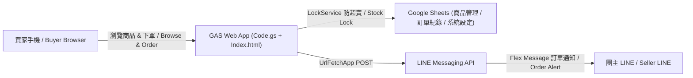
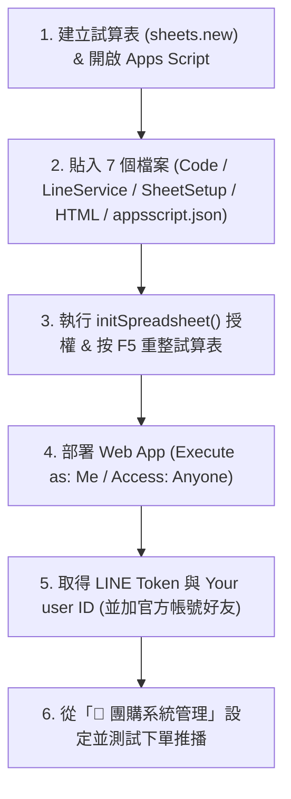

# 🍪 即期品零食網路團購系統 ｜ Short-Dated Snacks Group-Buy System

**(Google Apps Script + Google Sheets + LINE Messaging API)**

🌐 **教學文件 / Tutorials**：
- 🇹🇼 [**繁體中文完整教學（含流程圖）**](./docs/TUTORIAL.md)
- 🇺🇸 [**English Complete Tutorial (with Flowcharts)**](./docs/TUTORIAL.en.md)
- 🤖 **AI Agent Teaching Skill (Bilingual)**：[`.agents/skills/gas-line-group-buy/SKILL.md`](./.agents/skills/gas-line-group-buy/SKILL.md)

> ⚠️ **資安聲明 / Security Notice**：本倉庫**不包含任何** LINE Channel Access Token、Channel Secret、User ID 或真實 Google 試算表／部署網址。所有金鑰於部署時皆透過試算表選單寫入 GAS `PropertiesService.getScriptProperties()`。

---

## 系統運作流程圖 ｜ System Architecture

## 實作步驟總覽 ｜ Setup Roadmap

---

## 核心特色 ｜ Key Features

- **即期品效期倒數標籤 / Expiry Countdown Badges**：依剩餘天數顯示紅 / 橘 / 綠急迫度標籤，並自動隱藏過期商品。
- **防超賣庫存鎖 / Concurrency Stock Lock**：使用 `LockService.getScriptLock()` 確保多人搶購最後幾份商品時不超賣。
- **原價與團購價折扣計算 / Auto Discount Badges**：自動計算折數，提升即期品買氣。
- **LINE Messaging API 即時通知 / Real-Time LINE Alerts**：下單後即時推播 Flex Message 訂單卡片至團主 LINE 或群組（含純文字自動降級備援）。
- **雙語教學 + AI Skill / Bilingual Docs + Agent Skill**：支援繁體中文與英文教學手冊，並內建 `.agents/skills/` 讓學生的 AI 助理可逐步帶做。

---

## 倉庫檔案結構 ｜ Repository Structure

| 檔案 / 目錄 (File / Path) | 說明 (Description) | 貼入 GAS? |
| :--- | :--- | :---: |
| `Code.gs` | Web App (`doGet`)、Webhook (`doPost`)、商品讀取與 `submitOrder` | ✅ `Code` |
| `LineService.gs` | LINE Messaging API 推播 Flex Message、測試通知、金鑰彈窗設定 | ✅ `LineService` |
| `SheetSetup.gs` | 初始化試算表、範例即期零食、自訂選單 `🍱 團購系統管理` | ✅ `SheetSetup` |
| `Index.html` | 團購前台主頁面與結帳 / 收據彈窗 | ✅ `Index` |
| `Styles.html` | 前台響應式 CSS 樣式 | ✅ `Styles` |
| `Scripts.html` | 購物車管理與 `google.script.run` 非同步串接 | ✅ `Scripts` |
| `appsscript.json` | GAS 設定檔（`Asia/Taipei` 時區、Web App 匿名存取） | ✅ Manifest |
| `docs/TUTORIAL.md` | 繁體中文 6 關完整教學手冊（含流程圖） | ❌ |
| `docs/TUTORIAL.en.md` | English 6-Milestone Tutorial (with flowcharts) | ❌ |
| `.agents/skills/gas-line-group-buy/` | 雙語 AI Agent 教學 Skill 與中英文除錯手冊 | ❌ |
| `.gitignore` | 排除 `.env`、`.clasp.json`、`*.secret` 等本機機密 | ❌ |

---

## 除錯參考 ｜ Troubleshooting
- 🇹🇼 [繁體中文除錯指南](./.agents/skills/gas-line-group-buy/references/troubleshooting.md)
- 🇺🇸 [English Troubleshooting Guide](./.agents/skills/gas-line-group-buy/references/troubleshooting.en.md)
