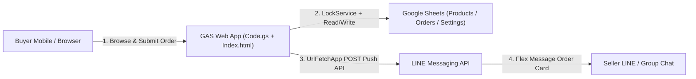
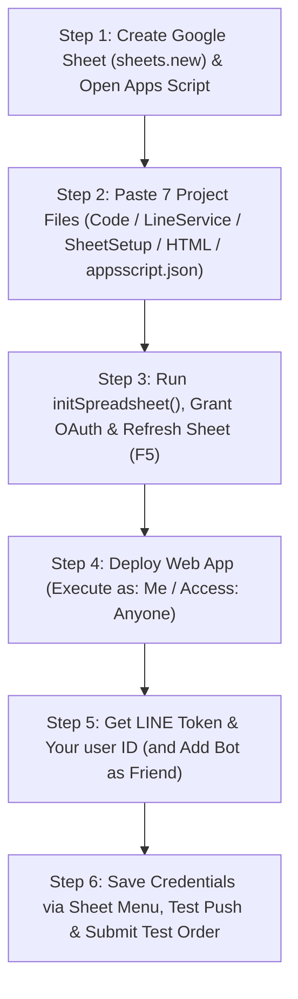
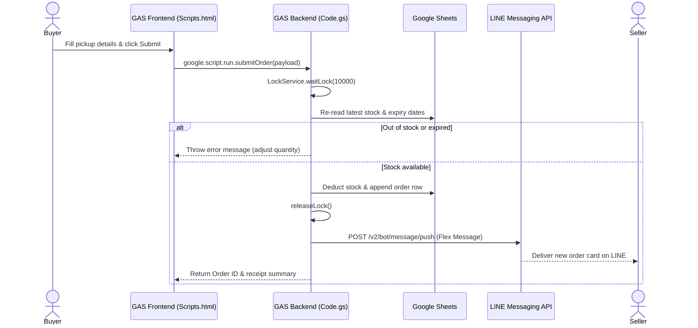

# 🍪 Student Step-by-Step Guide (English): Short-Dated Snacks Group-Buy System

🌐 **Language / 語言切換**：[繁體中文 (TUTORIAL.md)](./TUTORIAL.md) ｜ **English**

This tutorial guides you step-by-step to build and deploy a **zero-hosting-cost online group-buying system** for short-dated / near-expiry snacks using:
- **Frontend**: Google Apps Script (`HtmlService`) — expiry countdown badges, automatic discount labels, shopping cart, and pickup location selector
- **Backend / Database**: Google Sheets (`商品管理` Products, `訂單紀錄` Orders, `系統設定` Settings)
- **Real-time Seller Notifications**: LINE Messaging API — pushes a rich Flex Message order card to the seller's LINE whenever a customer places an order

> 💡 **AI Agent Tip for Students**: This repository includes [SKILL.md](../.agents/skills/gas-line-group-buy/SKILL.md). Open this repo with a Skill-aware AI coding assistant and ask: *"Please teach me how to build and deploy this group-buy system step by step"*, and it will walk you through every milestone and troubleshooting check.

---

## 1. Visual Flowcharts

### A. System Architecture

### B. 6-Milestone Student Setup Roadmap

### C. Anti-Overselling & Notification Sequence

---

## 2. Key Engineering & Security Concepts

1. **Preventing Overselling (`LockService`)**: Short-dated snacks have very limited inventory. `Code.gs` uses `LockService.getScriptLock()` so concurrent buyers cannot buy the same last unit simultaneously.
2. **Zero Hardcoded Secrets (`PropertiesService`)**: Your LINE `Channel access token` and `User ID` are **never** hardcoded in `.gs`, `.html`, or Sheet cells. They are stored securely in `PropertiesService.getScriptProperties()`.
3. **Server-Side Price Calculation**: The frontend sends only `productId` and `qty`. `submitOrder()` recalculates prices and totals from Google Sheets on the server to prevent client-side tampering.
4. **Phone Formatting & Formula Injection Guard**: Taiwan mobile numbers (`0912345678`) are formatted as plain text (`@`) so leading zeros are preserved, and user inputs starting with `=`, `+`, `-`, or `@` are escaped.

---

## 3. Step-by-Step Instructions (6 Milestones)

### Milestone 1: Create Google Sheet & Open Apps Script
1. Sign in to Google and visit https://sheets.new to create a blank spreadsheet.
2. Click **Extensions > Apps Script** (`擴充功能 > Apps Script`) in the top menu.

### Milestone 2: Paste the 7 Project Files into Apps Script
> ⚠️ **Do NOT paste `README.md` or tutorial docs.** Only paste these 7 files from the repo root:

| Local File | How to Add in Apps Script Editor |
| :--- | :--- |
| `Code.gs` | Replace the default `Code.gs` (`程式碼.gs`) |
| `LineService.gs` | Click `+` > **Script**, name it `LineService` |
| `SheetSetup.gs` | Click `+` > **Script**, name it `SheetSetup` |
| `Index.html` | Click `+` > **HTML**, name it `Index` (**no `.html`**, clear default boilerplate first) |
| `Styles.html` | Click `+` > **HTML**, name it `Styles` (same as above) |
| `Scripts.html` | Click `+` > **HTML**, name it `Scripts` (same as above) |
| `appsscript.json` | Click **Project Settings** (gear icon) > check **Show "appsscript.json" manifest file in editor** > return to Editor and overwrite |

Press `Ctrl + S` to save all files.

### Milestone 3: Initialize Database & Custom Menu
1. In Apps Script, select `SheetSetup.gs` and choose function **`initSpreadsheet`**, then click **Run**.
2. Approve the Google OAuth consent screen (**Advanced > Go to ... (unsafe) > Allow**).
3. Switch back to your Google Sheet and **press `F5` to refresh the page**. Wait 3–5 seconds:
   - You will see 3 new tabs: `商品管理` (with 4 sample snacks), `訂單紀錄`, and `系統設定`.
   - A custom menu **`🍱 團購系統管理`** will appear to the right of `Help`.

### Milestone 4: Deploy as a Web App
1. In Apps Script, click **Deploy > New deployment**.
2. Select type **Web app**:
   - **Execute as**: `Me`
   - **Who has access**: `Anyone` (allows buyers to order without signing in to Google)
3. Click **Deploy** and copy the generated `https://script.google.com/macros/s/.../exec` URL.
4. Open the URL in an incognito browser tab to preview your storefront!

### Milestone 5: Connect LINE Messaging API
> ⚠️ LINE Notify was discontinued in March 2025. This project uses **LINE Messaging API** (the free plan includes 200 push messages/month).

1. Sign in to [LINE Developers Console](https://developers.line.biz/console/).
2. Create or select a Provider and a **Messaging API** channel.
3. **Get your Token**: Open the **Messaging API** tab, scroll to **Channel access token (long-lived)**, and click **Issue**.
4. **Add the Bot on LINE**: Scan the QR code on that same page with your phone so the bot can send messages to you.
5. **Get your User ID (`U...`, 33 characters)**:
   - **Easiest Method**: Open the **Basic settings** tab and scroll to the bottom to copy **Your user ID**.
   - **Webhook Method**: Paste your `/exec` Web App URL into **Webhook URL**, enable **Use webhook** (note: clicking Verify on GAS shows `302 Found` due to Google's redirect architecture, which is normal), then message `綁定` to your bot in LINE to receive your `User ID` (or invite it to a group for `Group ID`).
6. Back in Google Sheets, click **`🍱 團購系統管理 > 2. 設定 LINE Token 與接收通知 ID`** and paste your Token and `U...` User ID.

### Milestone 6: Test Notification & End-to-End Order
1. In Google Sheets, click **`🍱 團購系統管理 > 3. 發送 LINE 測試通知`**. You should receive an orange Flex Message test order card on LINE!
2. Open your `/exec` Web App storefront, add snacks to the cart, enter test buyer details (e.g. phone `0912345678`), and submit. Verify:
   - `訂單紀錄` logs the new order with leading `0` preserved.
   - `商品管理` deducts the purchased `stock`.
   - Your LINE immediately receives the real order Flex Message.

---

## 4. Pre-Push Security Checklist (For Students Using GitHub)

Before pushing your own fork to GitHub, verify:
- [ ] No `Channel access token`, `Channel secret`, or `U...` User ID exists in any `.gs`, `.html`, or `.md` file.
- [ ] No private Google Sheet URLs or live Web App `/exec` URLs are committed.
- [ ] `.gitignore` is intact to exclude `.env`, `.clasp.json`, and local secrets.

---

## 5. Troubleshooting & Next Challenges
- Troubleshooting FAQ: [troubleshooting.en.md](../.agents/skills/gas-line-group-buy/references/troubleshooting.en.md)
- **Bonus Challenges**:
  1. Add a free-shipping progress bar using `系統設定`.
  2. Add a customer order-lookup function `lookupOrdersByPhone(phone)` in `Code.gs`.
  3. Add a daily GAS time-driven trigger to automatically mark expired snacks as `已過期`.
