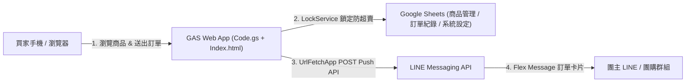
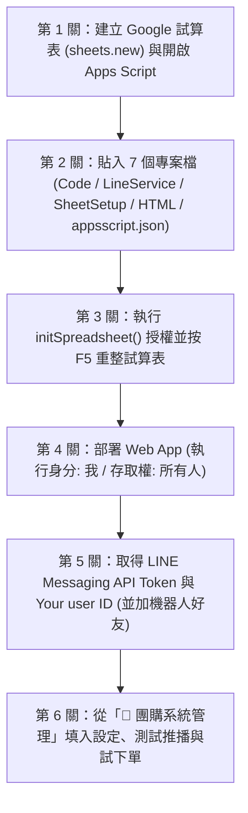
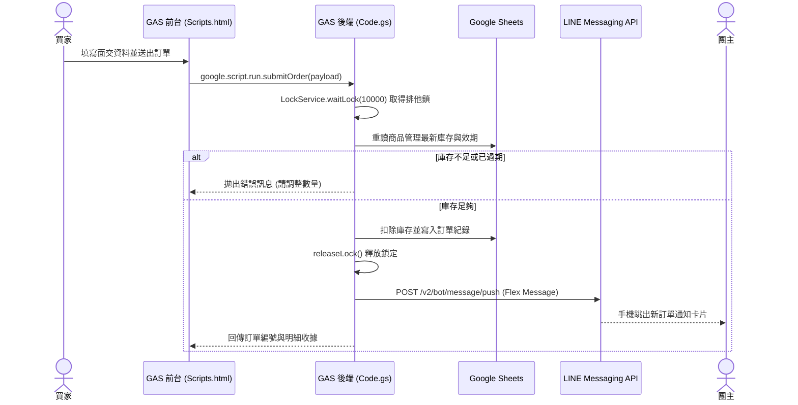

# 🍪 學生實作教學手冊（繁體中文）：打造即期品零食網路團購系統

🌐 **Language / 語言切換**：**繁體中文** ｜ [English Version (TUTORIAL.en.md)](./TUTORIAL.en.md)

本教學將帶你運用 **零主機成本** 的免費雲端工具，打造一套真實可上線運作的 **「即期品零食網路團購系統」**：
- **前端網頁**：Google Apps Script (`HtmlService`) — 含效期倒數標籤、折扣自動計算、購物車與面交地點選擇
- **後端資料庫**：Google Sheets — 直接當作後台管理商品、庫存與訂單
- **即時通知**：LINE Messaging API — 有人下單時，團主的 LINE 立刻收到結構化訂單卡片

> 💡 **AI Agent 學生使用提示**：本專案已內建 [SKILL.md](../.agents/skills/gas-line-group-buy/SKILL.md)！只要你用支援 Skills 的 AI 開發助理打開這個專案，直接跟它說「**請教我一步一步做完這個團購系統**」，它就會照步驟陪你實作與除錯。

---

## 一、流程圖快速看懂全系統

### 1. 系統整體資料流架構圖

### 2. 學生實作 6 關通關流程圖

### 3. 下單防超賣與 LINE 推播時序圖

---

## 二、核心工程與資安觀念

1. **即期品防超賣 (`LockService`)**：即期零食數量通常很少，如果兩位買家同時按結帳搶最後 1 包，`Code.gs` 的 `LockService.getScriptLock()` 會確保排隊檢查與扣減庫存，避免超賣。
2. **金鑰安全隔離 (`PropertiesService`)**：LINE `Channel access token` 與接收通知的 `User ID` **絕對不寫死在程式碼或公開的工作表**，而是透過 `ScriptProperties` 安全存放。
3. **價格在後端重算**：前端只傳送 `productId` 與 `qty`，實際單價與總金額一律由後端讀取 Google Sheets 重新計算，防止瀏覽器竄改價格。
4. **手機號碼防吃零**：台灣手機 `0912345678` 寫入試算表前會將欄位格式設為 `@`（純文字），避免開頭 `0` 消失，同時過濾 `=`, `+`, `-`, `@` 公式注入字元。

---

## 三、實作步驟（共 6 關）

### 第 1 關：建立 Google 試算表與開啟 Apps Script
1. 登入 Google 帳號，前往 https://sheets.new 建立一份新試算表（可命名為「即期零食團購後台」）。
2. 點選上方選單 **「擴充功能」 > 「Apps Script」**，開啟程式碼編輯器。

### 第 2 關：貼入專案程式碼（共 7 個檔案）
> ⚠️ **不要貼 `README.md` 與教學文件**，只需要將專案根目錄以下 7 個檔案貼進 Apps Script：

| 專案檔案 | 在 Apps Script 編輯器的建立方式 |
| :--- | :--- |
| `Code.gs` | 直接覆蓋預設的 `程式碼.gs` |
| `LineService.gs` | 點左側 `+` > **指令碼**，命名為 `LineService` |
| `SheetSetup.gs` | 點左側 `+` > **指令碼**，命名為 `SheetSetup` |
| `Index.html` | 點左側 `+` > **HTML**，命名為 `Index`（**不要加 `.html`**，貼上前先清空預設樣板） |
| `Styles.html` | 點左側 `+` > **HTML**，命名為 `Styles`（同上） |
| `Scripts.html` | 點左側 `+` > **HTML**，命名為 `Scripts`（同上） |
| `appsscript.json` | 點左側齒輪 **專案設定** > 勾選「在編輯器中顯示『appsscript.json』資訊清單檔案」> 回到編輯器覆蓋內容 |

完成後按 `Ctrl + S` 儲存全部檔案。

### 第 3 關：初始化資料庫與啟用自訂選單
1. 在 Apps Script 上方工具列選擇 **`SheetSetup.gs`**，函式下拉選擇 **`initSpreadsheet`**，點擊 **「執行」**。
2. 首次執行會跳出「需要授權」視窗：點選「審查權限 > 選擇你的 Google 帳號 > 進階 > 前往……（不安全）> 允許」。
3. 執行完成後，回到 Google 試算表 **按 `F5` 重新整理**，等 3 秒後你會看到：
   - 自動產生三個工作表：`商品管理`（含 4 筆範例零食）、`訂單紀錄`、`系統設定`。
   - 上方選單列最右邊多出 **`🍱 團購系統管理`**！

### 第 4 關：部署成團購前台網站 (Web App)
1. 回到 Apps Script 編輯器右上角，點選 **「部署」 > 「新增部署作業」**。
2. 左側齒輪選取類型：**「網頁應用程式」**，設定如下：
   - **執行身分**：`我`
   - **誰可以存取**：`所有人`（這樣買家不需登入 Google 就能逛與下單）
3. 點擊「部署」，複製產生的 **`https://script.google.com/macros/s/.../exec`** 網址。
4. 在瀏覽器無痕視窗打開這個網址，應該就會看到「甜心即期零食挖寶團」的商品頁與效期倒數標籤！

### 第 5 關：申請 LINE Messaging API 並綁定通知
> ⚠️ LINE Notify 已於 2025 年 3 月停止服務，本系統採用 **LINE Messaging API**（免費版每月含 200 則主動推播）。

1. 前往 [LINE Developers Console](https://developers.line.biz/console/) 登入。
2. 建立（或選擇）一個 Provider，新增 **Messaging API** Channel。
3. **取得 Token**：進入該 Channel 的 **Messaging API** 分頁，拉到最下方 **Channel access token (long-lived)**，點擊 **Issue** 產生並複製。
4. **用手機加機器人好友**：掃描同一頁的 QR Code 加入你的官方帳號為好友。
5. **取得你的 User ID（`U` 開頭，共 33 碼）**：
   - **最簡單方法**：切換到 **Basic settings** 分頁，拉到最下方找到 **「Your user ID」** 複製起來。
   - **進階 Webhook 法**：將第 4 關的 `/exec` 網址貼進 Messaging API 分頁的 **Webhook URL** 並開啟 **Use webhook**（註：點 Verify 時因 GAS 會先回 `302` 重導向而顯示失敗屬正常現象），接著對你的官方帳號傳送文字「`綁定`」，機器人即會回覆你的 `User ID`（或邀入群組後取得 `Group ID`）。
6. 回到 Google 試算表，點擊 **`🍱 團購系統管理 > 2. 設定 LINE Token 與接收通知 ID`**，依序貼入剛才的 Token 與 `U...` User ID。

### 第 6 關：測試推播與試下單驗收
1. 在試算表點選 **`🍱 團購系統管理 > 3. 發送 LINE 測試通知`**。
   - 若成功，試算表會跳出「測試通知發送成功！」，手機 LINE 會收到橘色標題的測試訂單卡片。
2. 打開第 4 關的 Web App 前台，選購零食並填寫姓名、手機（例如 `0912345678`）、面交地點後送出訂單，檢查：
   - `訂單紀錄` 多了一筆資料，且手機開頭 `0` 沒有不見。
   - `商品管理` 的 `stock` 庫存數正確扣減。
   - 手機 LINE 立刻收到正式訂單通知！

---

## 四、資安檢查清單（上傳 GitHub 前必讀）

在將自己的版本推上 GitHub 前，請務必確認：
- [ ] `.gs` 與 `.html` 程式碼內 **沒有** 任何 `Channel access token`、`Channel secret` 或 `U...` User ID。
- [ ] `README` 與文件內 **沒有** 貼上自己真實的 Google 試算表連結或已綁定的私密金鑰。
- [ ] `.gitignore` 已保留，避免本機 `.env`、`.clasp.json` 等設定檔被誤推。

---

## 五、常見除錯與進階挑戰
- 遇到錯誤時請參閱：[常見問題與除錯指南 (troubleshooting.md)](../.agents/skills/gas-line-group-buy/references/troubleshooting.md)
- **進階挑戰**：
  1. 在 `系統設定` 新增 `free_shipping_threshold` 實現滿額免運進度條。
  2. 在 `Code.gs` 新增 `lookupOrdersByPhone(phone)` 讓買家查詢訂單狀態。
  3. 使用 GAS 時間驅動觸發條件（Time-driven Trigger），每天凌晨自動將過期商品下架。
